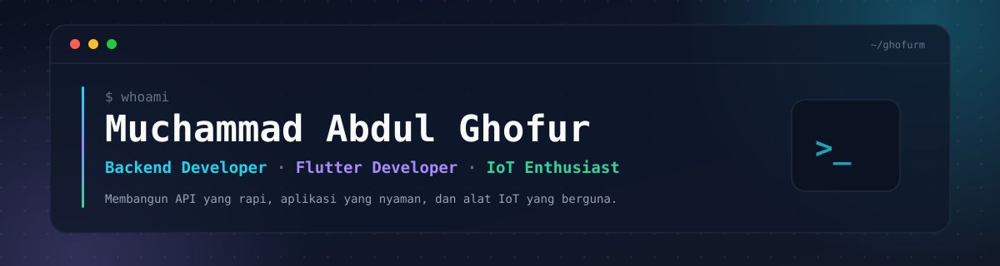

  

  
    
  
  

## 👋 Tentang Saya

Halo! Saya **Ghofur** — mahasiswa **Teknik Informatika** di **Universitas PGRI Semarang**. Saya menikmati proses membangun sesuatu dari nol: merancang API, menyusun antarmuka, sampai mengolah data dari sensor. Bagi saya, cara terbaik belajar adalah **membangun, mengukur, lalu memperbaiki**.

- 🔭 Saat ini sedang mengembangkan **Schoolyshop Backend v2** — API e-commerce untuk koperasi sekolah.
- 🌱 Memperdalam **arsitektur backend**, **keamanan API**, **pengujian**, dan **Flutter**.
- 🧩 Suka mengubah ide kecil menjadi proyek yang benar-benar jalan.
- 📱 Percaya bahwa aplikasi yang baik itu sederhana, cepat, dan enak dipakai.

## 🛠️ Tech Stack

**Bahasa**

  
  
  
  
  

**Backend & API**

  
  
  
  
  
  

**Mobile & IoT**

  
  
  
  

**Tools**

  
  
  
  

## 🚀 Proyek Pilihan

Beberapa proyek yang paling saya nikmati prosesnya:

| Proyek | Deskripsi | Stack |
| :--- | :--- | :--- |
| **[Schoolyshop Backend](https://github.com/Ghofurm/backend-schoolyshop-v2)** | REST API e-commerce koperasi sekolah — autentikasi sesi, katalog, keranjang, checkout, pembayaran Midtrans, pengiriman Biteship, dan dokumentasi OpenAPI. | `TypeScript` `Express` `PostgreSQL` `Drizzle` |
| **[Kopi Nusantara](https://github.com/Ghofurm/uts_mobile_programming)** | Katalog 10 kopi Nusantara dengan wizard rekomendasi tiga langkah, panduan seduh, dan tema Material 3. | `Flutter` `Dart` |
| **[NusaEdu Forms](https://github.com/Ghofurm/flutter_forms)** | Form pendaftaran akun portal akademik dengan validasi lengkap, dialog ringkasan, dan widget test. | `Flutter` `Dart` |
| **[Calisthenics Tracker](https://github.com/Ghofurm/tracking-latihan)** | Pencatat latihan calisthenics mingguan yang berjalan penuh di browser — tanpa backend, framework, atau build step. | `JavaScript` `localStorage` |
| **[Deteksi Penyakit Tanaman](https://github.com/Ghofurm/bme688-tanaman)** | Sistem IoT ESP32 + sensor BME688 dengan pipeline dataset ke Edge Impulse untuk deteksi penyakit tanaman. | `C/C++` `ESP32` `Python` |
| **[Kartu Mahasiswa](https://github.com/Ghofurm/student_card)** | Kartu mahasiswa digital multi-halaman dengan kartu yang bisa dibalik dan foto profil. | `Flutter` `Dart` |

<a href="https://github.com/Ghofurm?tab=repositories"><b>Lihat semua repositori →</b></a>

## 📈 GitHub dalam Angka

  

  
  

## 🤝 Mari Terhubung

Saya terbuka untuk kolaborasi, diskusi seputar backend, Flutter, dan IoT, atau sekadar bertukar ide. Jangan ragu untuk menjelajahi repositori saya dan meninggalkan bintang kalau ada yang berguna. ⭐

  
  

---

  <i>"Bangun, ukur, perbaiki — lalu ulangi."</i> 
  Terima kasih sudah mampir! 🚀

